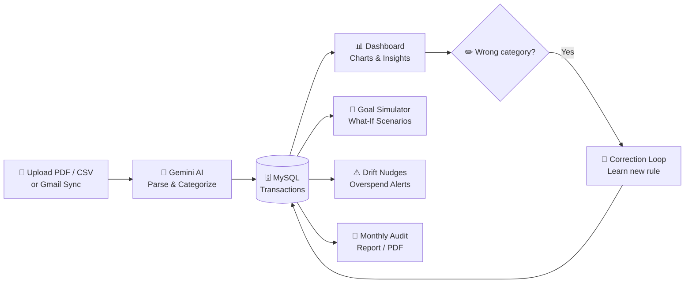

<div align="center">

# Finler AI

### Personal Finance Coach with a **Living Money Model**

*Your daily transactions, connected to your long-term goals, powered by AI.*

<br/>

[](https://php.net)
[](https://www.mysql.com)
[](https://ai.google.dev)
[](https://tailwindcss.com)
[](https://www.chartjs.org)
[](https://developer.mozilla.org/docs/Web/JavaScript)

[](#)
[](#)
[](#-license)

<br/>

**[✨ Features](#-core-features) • [🧠 How It Works](#-how-it-works) • [🛠️ Tech Stack](#️-tech-stack) • [📁 Structure](#-directory-structure) • [🚀 Installation](#-installation--setup) • [🔐 Security](#-security--compliance)**

</div>

---

## 📖 Overview

**Finler AI** is an advanced, AI-powered personal finance coach built for the **Product Space Agentic AI Hackathon**.

Traditional budgeting apps only *categorize* your expenses. **Finler AI goes further**: it builds a **living financial model** that connects your daily transactions with your long-term goals, learns from your corrections, and nudges you *before* you go off track.

> 💡 **Think of it as:** a coach that reads your bank statements, remembers your rules, and tells you exactly how much sooner you can reach your goals if you spend a little differently.

---

## ✨ Core Features

| | Feature | What it does |
|---|---|---|
| 📄 | **AI Statement Ingestion** | Parses PDF and CSV bank statements automatically using the Google Gemini API. |
| 🔁 | **The Correction Loop** | Fix a miscategorized item once, and the system learns the rule for all future transactions. |
| 🔔 | **Smart Subscriptions** | Tracks recurring bills, utility expenses and recurring payments in one place. |
| 👤 | **Persistent Financial Profile** | Stores income, fixed costs, emergency fund and target-date goals. |
| 🎯 | **What-If Goal Simulator** | Interactive scenario planner that shows how spending cuts accelerate goal completion. |
| ⚠️ | **Spending Drift Nudges** | Proactive warnings when discretionary spending goes off plan. |
| 🧾 | **Monthly Audit Reports** | Print-ready and PDF review reports of inflows and outflows. |
| 📧 | **Gmail Statement Sync** | Pulls statements straight from Gmail with `sync_gmail.php`. |

---

## 🧠 How It Works



1. **Ingest:** upload a bank statement (PDF/CSV) or sync from Gmail.
2. **Understand:** Gemini extracts and categorizes every transaction.
3. **Learn:** your corrections become rules the system applies automatically.
4. **Plan:** the goal simulator shows how changes in spending move your target dates.
5. **Stay on track:** drift nudges warn you early, and monthly reports keep you accountable.

---

## 🛠️ Tech Stack

| Layer | Technology |
|---|---|
| 🖥️ **Backend** | PHP 8.2, MySQL (PDO) |
| 🎨 **Frontend** | Tailwind CSS, JavaScript, Chart.js |
| 🤖 **AI Engine** | Google Gemini 3.6 Flash API |
| 🎙️ **Voice Workflow** | Wispr Flow |

---

## 📁 Directory Structure

```text
finler/
├── 📂 api/                   # JSON API endpoints
├── 📂 assets/                # Logos and icons
├── 📂 database/              # SQL database export (finler.sql)
├── 📂 includes/              # Database connection and templates
├── 📂 users/                 # User views and sidebars
├── 📄 .env.example           # Environment template
├── 📄 .htaccess              # Clean URL and security rules
├── 🔐 auth.php               # Authentication handler
├── 📊 dashboard.php          # Main dashboard view
├── 📑 export_pdf.php         # PDF financial statement exporter
├── 🏠 index.php              # Landing page
├── 🔑 login.php              # Login view
├── 🚪 logout.php             # Logout handler
├── 🧾 monthly_report.php     # Cashflow audit report
├── 🎯 save_goal.php          # Financial goals handler
├── ⚙️ settings.php           # User settings view
├── 📝 signup.php             # Registration handler
├── 📧 sync_gmail.php         # Gmail statement sync handler
├── 💳 transactions.php       # Transactions management view
├── 🔁 update_category.php    # Correction loop engine
└── ⬆️ upload_statement.php   # PDF/CSV statement uploader
```

---

## 🚀 Installation & Setup

### ✅ Prerequisites

- PHP **8.2+**
- MySQL / MariaDB
- A local server such as **XAMPP** or **WAMP**
- A **Google Gemini API key** from [Google AI Studio](https://aistudio.google.com/app/apikey)

### 1️⃣ Clone the repository

```bash
git clone https://github.com/irrathodofficial/finler.git
cd finler
```

### 2️⃣ Configure the database

1. Open **MySQL / phpMyAdmin**.
2. Create a new database named `finler`.
3. Import `database/finler.sql` to set up all required tables automatically.

### 3️⃣ Set up environment variables

Copy `.env.example` to `.env` in the root directory and update your credentials:

```env
DB_HOST=localhost
DB_USER=root
DB_PASS=
DB_NAME=finler
GEMINI_API_KEY=your_gemini_api_key_here
```

### 4️⃣ Run on a local server

Place the project folder inside your server directory:

| Server | Path |
|---|---|
| **XAMPP** | `xampp/htdocs/finler` |
| **WAMP** | `wamp/www/finler` |

Then open 👉 **http://localhost/finler** in your browser. 🎉

---

## 🔐 Security & Compliance

- 🛡️ Strict financial guardrails: Finler AI **does not give direct securities or trading advice**.
> ⚠️ **Disclaimer:** Finler AI is a budgeting and planning assistant, not a licensed financial advisor.

---

## 🗺️ Roadmap

- [ ] 📱 Mobile-friendly PWA
- [ ] 🌐 Multi-currency support
- [ ] 🏦 More bank statement formats
- [ ] 🎙️ Voice-first expense logging

---

## 🤝 Contributing

Contributions, issues and feature requests are welcome!

1. 🍴 Fork the project
2. 🌿 Create your feature branch (`git checkout -b feature/AmazingFeature`)
3. 💾 Commit your changes (`git commit -m 'Add AmazingFeature'`)
4. 🚀 Push to the branch (`git push origin feature/AmazingFeature`)
5. 🔃 Open a Pull Request

---

## 📜 License

Distributed under the **MIT License**.

---

<div align="center">

### 👨‍💻 Author

**Ishwar Rathod**

[](https://github.com/irrathodofficial)

Built with ❤️ for the **Product Space Agentic AI Hackathon** using **Wispr Flow** 🎙️

⭐ **If you like this project, give it a star on GitHub!** ⭐

</div>
